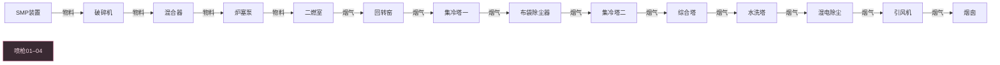

# 微沸喷烧全流程数据模型（Phase 1–6）：设备接口、工业管道、流体示踪、工艺区域分层、上下游追踪与流程播放

> 状态：**Phase 1 数据模型 + Phase 2 设备接口与连接关系 + Phase 3 工业管道教学示意 + Phase 4 流体教学示意 + Phase 5 五区工艺分层与三维流程导航 + Phase 6 智能上下游追踪与 15 步完整流程播放**。截至 2026-11-18，本流程已有 14 类参数化外部教学模型（含法兰接管口）、可校验的设备—接口—管线—上下游连接图、18 个设备实例的教学布局、13 条正交管线（端部法兰/弯头/示意阀/支架）、按阀门状态联动的示踪粒子和流向箭头、5 个工艺区域的分层显示与区域校验，以及由同一流程数据驱动的有向追踪引擎、四喷枪平行支路、二维 PROCESS MAP 和带暂停/停止/重置/调速/跳转的 15 步教学流程播放；`#/boil` 页面已接入站点路由与首页入口，并已作为第 9 轮发布（actionId `4d09eac8-dd3b-4c01-b19f-27d9e40f0850`，build `index-Dogxmmsu.js`）；工作副本最终构建 `index-tIyhduJ7.js` 含发布后小修正，未再次发布。
> 本文是数据台账、接口/路由台账与边界说明，不是工艺包、管道设计或安全评价依据。设备外形比例、教学布局、管线走向、阀门型式/位置与支架间距均为教学示意，不是工程坐标、制造尺寸或施工图。

## 1. 来源与边界

- 设备名称与顺序来自用户提供的《DeepSeek Coding Agent 专用开发总指令》§5、§11、§18、§20、§45（2026-11-18）中的微沸喷烧流程清单。
- Phase 1 建立「工艺区 → 工序 → 设备实例 → 接口 → 管线 → 流线」的数据关系，并做结构化校验。
- Phase 2 建立设备外部教学模型、法兰接管口与接口—管线—上下游连接关系；模型外形比例、接口朝向和位置均为教学示意，不是工程尺寸。
- Phase 3 建立设备教学布局、设备简化避让盒、13 条管线的正交教学路由与端部法兰/弯头/示意阀/支架，并做路由穿模、设备重叠与支架冲突检查；布局/路由/阀门/支架均为教学示意，不是工程坐标或管道设计。
- Phase 4 建立阀门状态联动的流体教学示意：13 条管线各 1 个示意阀，示踪粒子与流向箭头沿管线中心线运动，关闭/部分开度只影响所在教学流线；不是 CFD、工艺仿真或真实流量/压力/温度计算。
- Phase 5 建立五个工艺区域的数据归属、上下游与教学说明，并在 `#/boil` 页面提供区域分层显示、可折叠流程树、设备/管线三维定位、关联流体弱化与区域完整性校验；区域三维范围由教学布局设备模型包络推导（含 0.4 m 教学缓冲），不是工程分区坐标。
- Phase 5 的四根喷枪按用户结构要求挂为二燃室的四个独立平行支路（`parentEquipmentId=eq-secondary-chamber`、`relationKind=parallel-branch`），不串成连续工艺节点；接入位置、喷入介质与来源仍待现场确认，未建立已确认硬连接。
- Phase 6 的追踪引擎只用管线端点与结构支路建图，不按页面顺序推断；路径遍历使用 visited/onPath 防循环，多分支返回全部简单路径；播放状态机只用既有 15 步数据，每步 4 秒是教学演示节奏，不是工艺停留时间；二维地图与三维场景读取同一份 `BOIL_PROCESS`。
- 未引用厂商图纸、工艺包、物料/热量衡算或第三方模型；没有编造型号、厂家、材料牌号、温度、压力、流量、浓度、pH、烟气成分、处理能力、停留时间等参数。
- 未提供的连接关系、结构类型和命名差异一律标 `pending-confirmation`，不强行连死。

## 2. 文件与命令

| 文件 | 作用 |
| --- | --- |
| `src/data/processTypes.ts` | 通用流程类型：`ProcessDefinition / ProcessAreaDef / ProcessStepDef / EquipmentInstanceDef / PortDef / PipelineDef / FlowStreamDef / ProcessGap`；Phase 2 增加 `modelKey` 与 `modelPortId`；Phase 3 增加 `PipelineRouteDef`（管径等级/示意阀/支架间距）；Phase 5 为区域增加管线/流线/上下游/教学说明字段，为设备增加结构关联父设备字段 |
| `src/data/boilProcess.ts` | 微沸喷烧唯一流程数据源：5 区、15 工序、18 实例、13 管线、2 流线、17 个缺口；每台设备带 `modelKey`，每条管线带 Phase 3 教学示意路由配置；Phase 5 补齐区域说明/教学说明，四根喷枪挂为二燃室平行支路（`dataVersion=2026-11-18.4`） |
| `src/data/boilLayout.ts` | Phase 3 设备教学布局（18 实例位置/朝向）与 14 类设备的简化避让盒（只用于路由穿模与支架避让） |
| `src/engine/boilModels.ts` | 14 类参数化外部教学模型与法兰接管锚点（仅外部形体，不含内部结构）；Phase 3 增加模型包围盒查询 |
| `src/process/connections.ts` | 设备接口—管线—上下游连接图、路径追踪、模型接口一致性校验 |
| `src/process/validate.ts` | Phase 1 数据校验器：id/引用/方向/介质/连通/流线连续性/待确认项汇总 |
| `src/process/piping.ts` | Phase 3 教学路由与穿模校验：世界接口坐标、正交候选路由、端部法兰、示意阀/支架落点、尺寸一致性与设备重叠检查 |
| `src/engine/boilPiping.ts` | Phase 3 管道几何库：直管/弯头/法兰/示意阀/支架/三档管径与部件库（三通/变径仅部件库演示） |
| `src/process/fluid.ts` | Phase 4 流体教学逻辑：阀位弧长、两条独立流线传播、`open/partial/closed` 状态、全开/逐阀关闭/逐阀部分开度校验（纯 TS，无 Three.js） |
| `src/engine/boilFluid.ts` | Phase 4 流体渲染：管外表面示踪粒子、合并流向箭头、阀门状态灯（绿/黄/红）与播放/速度/箭头控制；Phase 5 增加 `setEmphasis` 聚焦弱化 |
| `src/process/trace.ts` | Phase 6 工艺追踪引擎：18 设备节点、13 条工艺边、4 条喷枪平行支路边；上游/下游/完整路径、多分支、visited 循环保护、待确认接口与支路组 |
| `src/process/playback.ts` | Phase 6 播放状态机：15 步顺序、idle/playing/paused/completed、0.5/1/2/4 倍、上一步/下一步/跳转、步骤计时与 `validatePlayback` |
| `src/boil/map.ts` | Phase 6 二维 PROCESS MAP（SVG）：与三维同源，节点/管线箭头/四喷枪虚线支路/高亮/缩放/平移/节点定位 |
| `src/process/areas.ts` | Phase 5 区域模型与 `ProcessAreaValidator`：区域设备/管线/流线归属、上下游、入口/出口、三维范围、区域设备树、设备工艺上下游；校验无归属/重复归属/清单不一致/错误上下游/成环/范围重叠/喷枪支路 |
| `src/boil/scene.ts` / `ui.ts` / `boil.css` / `phase6.css` | `#/boil` Phase 5/6 页面：区域分层、流程树、设备/管线拾取、关联流体、平滑镜头；Phase 6 增加追踪/播放叠加态、四喷枪虚线支路、底部 PROCESS CONTROL、设备信息同步、二维地图、追踪历史与窄屏适配 |
| `scripts/validate-boil-process.mjs` | Node 校验入口：Phase 1 + Phase 2 + Phase 3 + Phase 4 + Phase 5 + Phase 6 一次运行（含追踪/播放 17 项检查） |
| `scripts/preview/boil-models.html` | Phase 2 内部验证预览页（Vite 开发服务专用，不进入站点路由） |
| `scripts/preview/boil-piping.html` | Phase 3 内部验证预览页：整线布局、单管线聚焦、部件库（`?gallery=1`） |
| `scripts/preview/boil-fluid.html` | Phase 4 内部验证预览页：整线/物料段/烟气段/阀近景、阀门状态表、播放/速度/箭头开关、点击三维阀门切换 |
| `scripts/verify-boil-models.mjs` | Phase 2 浏览器预览验证：14 类模型、36 个数据接口、模型锚点与截图（10 项） |
| `scripts/verify-boil-piping.mjs` | Phase 3 浏览器预览验证：路由/法兰/弯头/阀/支架/穿模/部件库与截图（20 项） |
| `scripts/verify-boil-fluid.mjs` | Phase 4 浏览器预览验证：初始全开、关阀停止/下游断流、部分开度传播、恢复、暂停/速度/箭头、HUD 与三维交互（37 项 + 截图） |
| `scripts/verify-boil-areas.mjs` | Phase 5 页面专项验证：五区/流程树/区域联动/设备与管线三维点选/上下游/复位/无重建/900px 与 390px 窄屏（52 项 + 截图与 `report.json`） |
| `npm run validate:boil` | 运行 Phase 1 数据 + Phase 2 接口/连接 + Phase 3 路由/穿模 + Phase 4 流体传播 + Phase 5 区域分层校验；错误退出码 1，仅有待确认警告时退出码 0 |
| `scripts/verify-boil-playback.mjs` | Phase 6 页面专项验证：追踪、分支/循环、15 步播放、暂停/停止/重置、速度/跳转、摄像机/流体同步、四喷枪、二维地图、历史、性能（22 项 + 截图/`report.json`） |
| `npm run verify:boil:areas` | 运行 Phase 5 浏览器专项验证（需先启动 dev server；`VERIFY_BASE` 可覆盖地址） |
| `npm run verify:boil:playback` | 运行 Phase 6 浏览器专项验证（使用生产构建 `dist`；运行前先 `npm run build`） |

## 3. 数据关系总览

```text
ProcessDefinition
  ├─ ProcessAreaDef（5 个工艺区）
  ├─ ProcessStepDef（15 道教学工序）
  ├─ EquipmentInstanceDef（18 个实例 / 14 类设备）
  │    ├─ modelKey → BoilModelDef（外部教学模型）
  │    └─ PortDef（进/出接口；流程边界口与待确认口显式标记）
  ├─ PipelineDef（13 条拓扑管线：from 设备+接口 → to 设备+接口）
  │    └─ PipelineRouteDef（Phase 3：管径等级、示意阀、支架间距上限）
  ├─ FlowStreamDef（物料流、烟气流）
  ├─ ConnectionGraph（Phase 2：接口连接、上游/下游、完整路径）
  ├─ EquipmentPlacementDef / LocalKeepoutBoxDef（Phase 3：教学布局与简化避让盒）
  ├─ PipeRouteResult（Phase 3：世界接口坐标、正交中心线、弯头、阀/支架/法兰落点）
  ├─ BoilFluidSnapshot（Phase 4：每管流动/节流/停止/断流、供料与未供料设备）
  └─ ProcessGap（17 个待确认缺口）
```

数据中刻意没有温度、压力、流量、浓度、型号、厂家、材料牌号等字段；后续阶段也不得在界面或数据中补占位假值。设备模型只建外部形体与接管口，内部结构留到 Phase 6。Phase 3 的路由坐标为教学示意生成值，不是工程坐标；管径等级/阀/支架也未从来源确认。

## 4. 5 个工艺区

| 序号 | 工艺区 | 教学作用 | 设备实例 | 工序 |
| --- | --- | --- | --- | --- |
| 1 | 物料准备 | 物料接收、破碎、混合与输送 | SMP装置、破碎机、混合器、炉塞泵 | 1–4 |
| 2 | 燃烧处理 | 物料燃烧处理与烟气生成 | 二燃室、喷枪01–04、回转窑 | 5–7 |
| 3 | 冷却与除尘 | 烟气冷却与除尘 | 集冷塔一、布袋除尘器、集冷塔二 | 8–10 |
| 4 | 湿法净化 | 烟气湿法净化 | 综合塔、水洗塔、湿电除尘 | 11–13 |
| 5 | 尾气排放 | 烟气输送与高点排放 | 引风机、烟囱 | 14–15 |

## 5. 15 道教学工序

| 序号 | 工序 | 工艺区 | 设备实例 | 出口管线 | 数据状态 |
| --- | --- | --- | --- | --- | --- |
| 1 | SMP装置 | 物料准备 | `eq-smp` | `pipe-material-01` | 教学示意 |
| 2 | 破碎机 | 物料准备 | `eq-crusher` | `pipe-material-02` | 教学示意 |
| 3 | 混合器 | 物料准备 | `eq-mixer` | `pipe-material-03` | 教学示意 |
| 4 | 炉塞泵 | 物料准备 | `eq-furnace-pump` | `pipe-material-04` | 待确认（泵型） |
| 5 | 二燃室 | 燃烧处理 | `eq-secondary-chamber` | `pipe-gas-01` | 待确认（流/烟分界） |
| 6 | 四根喷枪 | 燃烧处理 | `eq-spray-gun-01`–`04` | 无（接入待确认） | 待确认 |
| 7 | 回转窑 | 燃烧处理 | `eq-rotary-kiln` | `pipe-gas-02` | 教学示意 |
| 8 | 集冷塔一 | 冷却与除尘 | `eq-quench-1` | `pipe-gas-03` | 教学示意 |
| 9 | 布袋除尘器 | 冷却与除尘 | `eq-baghouse` | `pipe-gas-04` | 教学示意 |
| 10 | 集冷塔二 | 冷却与除尘 | `eq-quench-2` | `pipe-gas-05` | 教学示意 |
| 11 | 综合塔 | 湿法净化 | `eq-comprehensive-tower` | `pipe-gas-06` | 待确认（塔型/命名） |
| 12 | 水洗塔 | 湿法净化 | `eq-wash-tower` | `pipe-gas-07` | 教学示意 |
| 13 | 湿电除尘 | 湿法净化 | `eq-wet-esp` | `pipe-gas-08` | 教学示意 |
| 14 | 引风机 | 尾气排放 | `eq-id-fan` | `pipe-gas-09` | 教学示意 |
| 15 | 烟囱 | 尾气排放 | `eq-stack` | 无（排放边界） | 教学示意 |

约定：每道工序登记其设备的**出口管线**；13 条管线在工序中恰好各出现一次（`validate:boil` 强制）。工序序号必须从 1 连续编号；新增或调整步骤时需重排序号，并同步更新设备/管线的工序归属。

## 6. 18 个设备实例

所有实例的 `modelSource` 均为 `procedural`；Phase 2 已为 18 个实例建立 14 类参数化外部教学模型，`modelStatus` 均为 `available`。模型只含外部形体和法兰接管口，内部结构、可拆件与检修细节仍未建立（Phase 6）。下表保留 Phase 1 的实例台账；模型键映射与接口锚点见 §6.1、§6.2。

| 实例 id | 名称 | 工艺区 | 工序 | 数据状态 | 关键缺口 |
| --- | --- | --- | --- | --- | --- |
| `eq-smp` | SMP装置 | 物料准备 | 1 | 教学示意 | SMP 组成/结构未提供；来料边界 |
| `eq-crusher` | 破碎机 | 物料准备 | 2 | 教学示意 | 内部结构与破碎方式未提供 |
| `eq-mixer` | 混合器 | 物料准备 | 3 | 教学示意 | 混合方式与内件未提供 |
| `eq-furnace-pump` | 炉塞泵 | 物料准备 | 4 | 待确认 | 泵型（柱塞/螺杆/其他）未确认 |
| `eq-secondary-chamber` | 二燃室 | 燃烧处理 | 5 | 待确认 | 物料流/烟气流分界点；炉膛结构 |
| `eq-spray-gun-01` | 喷枪01 | 燃烧处理 | 6 | 待确认 | 接入位置、喷入介质与来源 |
| `eq-spray-gun-02` | 喷枪02 | 燃烧处理 | 6 | 待确认 | 同上 |
| `eq-spray-gun-03` | 喷枪03 | 燃烧处理 | 6 | 待确认 | 同上 |
| `eq-spray-gun-04` | 喷枪04 | 燃烧处理 | 6 | 待确认 | 同上 |
| `eq-rotary-kiln` | 回转窑 | 燃烧处理 | 7 | 教学示意 | 筒体/内部运动/停留时间未提供 |
| `eq-quench-1` | 集冷塔一 | 冷却与除尘 | 8 | 教学示意 | 冷却方式；名称“急冷/集冷”待统一 |
| `eq-baghouse` | 布袋除尘器 | 冷却与除尘 | 9 | 教学示意 | 滤袋/花板/灰斗/清灰未提供 |
| `eq-quench-2` | 集冷塔二 | 冷却与除尘 | 10 | 教学示意 | 冷却方式；名称待统一 |
| `eq-comprehensive-tower` | 综合塔 | 湿法净化 | 11 | 待确认 | 塔型/吸收或中和工艺；名称“中合/综合” |
| `eq-wash-tower` | 水洗塔 | 湿法净化 | 12 | 教学示意 | 喷淋方式、水质与循环量未提供 |
| `eq-wet-esp` | 湿电除尘 | 湿法净化 | 13 | 教学示意 | 电场/集尘极/电气参数未提供 |
| `eq-id-fan` | 引风机 | 尾气排放 | 14 | 教学示意 | 风机型式与风量/风压未提供 |
| `eq-stack` | 烟囱 | 尾气排放 | 15 | 教学示意 | 排放高度、监测与排放参数未提供 |

### 6.1 模型键与外部教学模型（Phase 2）

| 模型键 | 模型 | 实例 | 外形包围盒（教学示意，m） | 接口 | 模型边界 |
| --- | --- | --- | --- | --- | --- |
| `smp` | SMP装置 | 1 | 4.64 × 3.73 × 2.80 | `feedIn`、`discharge` | 组成与内部结构未提供；外部按接收/预处理单元示意 |
| `crusher` | 破碎机 | 1 | 3.09 × 3.23 × 2.83 | `materialIn`、`materialOut` | 破碎方式与内部结构未提供 |
| `mixer` | 混合器 | 1 | 2.38 × 5.43 × 2.19 | `materialIn`、`materialOut` | 混合方式与内件未提供 |
| `furnace-pump` | 炉塞泵 | 1 | 3.21 × 2.02 × 1.50 | `materialIn`、`materialOut` | 泵型未确认；按通用容积泵示意，不代表具体型式 |
| `secondary-chamber` | 二燃室 | 1 | 3.29 × 6.80 × 3.13 | `materialIn`、`gasOut` | 炉膛结构与燃烧组织未提供 |
| `spray-gun` | 喷枪 | 4（01–04） | 3.22 × 1.66 × 0.70 | `feedIn`、`nozzleOut` | 喷入介质、喷嘴型式与接入位置未确认 |
| `rotary-kiln` | 回转窑 | 1 | 8.66 × 3.68 × 3.34 | `gasIn`、`gasOut` | 筒体尺寸、倾角、转速与内部运动未提供 |
| `quench-tower` | 集冷塔 | 2（一/二） | 2.89 × 9.93 × 2.69 | `gasIn`、`gasOut` | 冷却方式与塔内件未提供 |
| `baghouse` | 布袋除尘器 | 1 | 5.37 × 5.78 × 5.37 | `gasIn`、`gasOut` | 滤袋、花板、净气室、灰斗与清灰方式未提供 |
| `comprehensive-tower` | 综合塔 | 1 | 3.63 × 9.93 × 3.60 | `gasIn`、`gasOut` | 塔型与吸收/中和工艺未确认 |
| `wash-tower` | 水洗塔 | 1 | 2.58 × 7.65 × 2.38 | `gasIn`、`gasOut` | 喷淋方式、水质与循环量未提供 |
| `wet-esp` | 湿电除尘 | 1 | 3.96 × 7.38 × 3.96 | `gasIn`、`gasOut` | 电场、集尘极、喷淋与电气参数未提供 |
| `id-fan` | 引风机 | 1 | 2.80 × 3.43 × 2.74 | `gasIn`、`gasOut` | 风机型式、叶轮与风量/风压未提供 |
| `stack` | 烟囱 | 1 | 3.23 × 11.57 × 3.00 | `gasIn`、`emissionOut` | 排放高度、内衬、监测与排放参数未提供 |

外形包围盒用于内部预览和碰撞检查，是教学比例，不是设备总图尺寸；法兰接管口只表达“有接口”，不代表法兰标准、公称压力或密封面型式。

### 6.2 接口锚点与接口台账

- 14 类模型共登记 **28 个模型接口锚点**；18 个实例共 **36 个数据接口**（每台 2 个）。
- 接口分类：**已连接 26**、**流程边界 2**（`eq-smp.feedIn` 来料、`eq-stack.emissionOut` 排放）、**待确认 8**（4 根喷枪的 `feedIn`/`nozzleOut`）、**未连接且未标待确认 0**。
- 数据接口通过 `modelPortId`（缺省等于 `port.id`）引用模型锚点；校验器逐项核对 id、角色、介质与边界标记。
- 模型接口由短节 + 法兰盘 + 4 个螺栓头组成，锚点位于法兰外端面，法线为外法线；局部坐标为教学示意，不是工程接口坐标。
- 四根喷枪仍**不建立**与二燃室/回转窑的硬连接，不并入物料流或烟气流；该关系继续登记为 `gap-spray-gun-connection`。

### 6.3 连接关系台账（Phase 2）

| 设备实例 | 上游 | 下游 | 已连接接口 | 未连接 / 边界 / 待确认 |
| --- | --- | --- | --- | --- |
| `eq-smp` | 外部来料（边界） | `eq-crusher` | `discharge` | `feedIn`（边界） |
| `eq-crusher` | `eq-smp` | `eq-mixer` | `materialIn`、`materialOut` | — |
| `eq-mixer` | `eq-crusher` | `eq-furnace-pump` | `materialIn`、`materialOut` | — |
| `eq-furnace-pump` | `eq-mixer` | `eq-secondary-chamber` | `materialIn`、`materialOut` | — |
| `eq-secondary-chamber` | `eq-furnace-pump` | `eq-rotary-kiln` | `materialIn`、`gasOut` | — |
| `eq-spray-gun-01`–`04` | — | — | — | `feedIn`、`nozzleOut`（待确认） |
| `eq-rotary-kiln` | `eq-secondary-chamber` | `eq-quench-1` | `gasIn`、`gasOut` | — |
| `eq-quench-1` | `eq-rotary-kiln` | `eq-baghouse` | `gasIn`、`gasOut` | — |
| `eq-baghouse` | `eq-quench-1` | `eq-quench-2` | `gasIn`、`gasOut` | — |
| `eq-quench-2` | `eq-baghouse` | `eq-comprehensive-tower` | `gasIn`、`gasOut` | — |
| `eq-comprehensive-tower` | `eq-quench-2` | `eq-wash-tower` | `gasIn`、`gasOut` | — |
| `eq-wash-tower` | `eq-comprehensive-tower` | `eq-wet-esp` | `gasIn`、`gasOut` | — |
| `eq-wet-esp` | `eq-wash-tower` | `eq-id-fan` | `gasIn`、`gasOut` | — |
| `eq-id-fan` | `eq-wet-esp` | `eq-stack` | `gasIn`、`gasOut` | — |
| `eq-stack` | `eq-id-fan` | 排放（边界） | `gasIn` | `emissionOut`（边界） |

连接图校验：13 条有向连接边、26 个已连接接口、上游/下游路径各 2 条（物料流与烟气流）均与设备顺序一致；主流线无孤立设备、无重复连接、无有向环。4 根喷枪为显式待确认的独立件，未并入主流线。



> 图中未画喷枪到二燃室/回转窑的连线：四根喷枪的接入位置、分配、喷入介质与来源均未确认，按 `pending-confirmation` 保留。


接口坐标说明：Phase 1 数据接口只登记 id、名称、进出与介质，不存局部坐标；Phase 2 由参数化模型提供接口锚点（局部坐标 + 外法线，教学示意，**非工程接口坐标**），数据侧用 `modelPortId` 引用并校验一致性。接口位置不代表设备总图、制造尺寸或现场安装坐标。

### 6.4 教学布局与设备避让盒（Phase 3）

18 个实例按主流程沿 +X 方向排列；四根喷枪放在主流程 +Z 侧（二燃室与回转窑之间），不接任何管线。模型归一化规则：包围盒中心 xz 对齐布局点、包围盒最低点落地。

| 实例 | x (m) | z (m) | 水平朝向 | 简化避让盒主要高度 |
| --- | ---: | ---: | --- | --- |
| `eq-smp` | 0 | 0 | 0° | 3.6 |
| `eq-crusher` | 5.8 | 0 | 0° | 3.2 |
| `eq-mixer` | 10.6 | 0 | 0° | 5.45（含顶部驱动） |
| `eq-furnace-pump` | 15.2 | 0 | 0° | 2.0 |
| `eq-secondary-chamber` | 21.0 | 0 | 0° | 6.8 |
| `eq-spray-gun-01` | 21.0 | 7.0 | 0° | 1.75 |
| `eq-spray-gun-02` | 24.8 | 7.0 | 0° | 1.75 |
| `eq-spray-gun-03` | 28.6 | 7.0 | 0° | 1.75 |
| `eq-spray-gun-04` | 32.4 | 7.0 | 0° | 1.75 |
| `eq-rotary-kiln` | 29.0 | 0 | 0° | 3.4 |
| `eq-quench-1` | 37.0 | 0 | 180° | 9.9（含顶部排气段） |
| `eq-baghouse` | 44.5 | 0 | 0° | 5.3 |
| `eq-quench-2` | 51.5 | 0 | 180° | 9.9（含顶部排气段） |
| `eq-comprehensive-tower` | 58.5 | 0 | 180° | 9.9（含顶部排气段） |
| `eq-wash-tower` | 65.5 | 0 | 0° | 6.6 |
| `eq-wet-esp` | 73.0 | 0 | 0° | 6.9 |
| `eq-id-fan` | 80.0 | 0 | 0° | 3.45 |
| `eq-stack` | 87.0 | 0 | 0° | 11.6 |

- 布局坐标、朝向、间距与管廊车道均为**教学示意**，不是装置总平面图或现场安装定位。
- 避让盒是程序化模型的简化包络，只覆盖主要壳体/机架，**不含接管法兰、爬梯、顶部小管**；只用于路由穿模、设备重叠与支架避让，不表示设备真实外形包络。
- 校验：18 个布局、0 个未知/重复布局、0 对设备避让盒重叠（0.05 m 容差）。
- 四根喷枪的 8 个接口仍为待确认、不接管线；SMP 来料口与烟囱排放口为流程边界，也不接内部管线。

## 7. 两条主流线

### 7.1 物料流（`flow-material`）

```text
SMP装置 → 破碎机 → 混合器 → 炉塞泵 → 二燃室
```

- 设备序列 5 个，管线 4 条（`pipe-material-01`–`04`）。
- 物料状态、成分、物性与流量未提供；`media-material` 的 `phase=mixed` 仅用于教学区分。

### 7.2 烟气流（`flow-flue-gas`）

```text
二燃室 → 回转窑 → 集冷塔一 → 布袋除尘器 → 集冷塔二
      → 综合塔 → 水洗塔 → 湿电除尘 → 引风机 → 烟囱
```

- 设备序列 10 个，管线 9 条（`pipe-gas-01`–`09`）。
- 烟气温度、成分、流量、含湿量、排放指标均未提供；不得在界面显示假数值。

### 7.3 四根喷枪

按源清单，喷枪位于二燃室与回转窑之间；但四根喷枪分别接到二燃室还是回转窑、接入位置、喷入介质与来源均未确认。Phase 1/2：

- 登记 4 个设备实例和 8 个接口，均标 `pending-confirmation`；
- **不建立**喷枪与二燃室/回转窑的硬连接；
- 不把喷枪并入物料流或烟气流；
- 在工序 6 和缺口 `gap-spray-gun-connection` 中显式列出；
- Phase 2 已建立喷枪外部模型与两个接口锚点（`feedIn`、`nozzleOut`），但仍不建立硬连接。

## 8. 13 条拓扑管线与 Phase 3 教学路由

Phase 2 只登记拓扑连接与接口关系；Phase 3 已为 13 条管线建立教学示意正交路由。管径等级、阀门型式/位置、支架间距与管件配置仍未从来源确认，`designNote` 与 `gap-no-pipeline-details`、`gap-piping-teaching-geometry` 明确标注。管线所属工艺区按接收设备所在区登记。

| 管线 id | 从 | 到 | 介质 | 流线 | 数据状态 |
| --- | --- | --- | --- | --- | --- |
| `pipe-material-01` | `eq-smp.discharge` | `eq-crusher.materialIn` | 物料 | 物料流 | 教学示意 |
| `pipe-material-02` | `eq-crusher.materialOut` | `eq-mixer.materialIn` | 物料 | 物料流 | 教学示意 |
| `pipe-material-03` | `eq-mixer.materialOut` | `eq-furnace-pump.materialIn` | 物料 | 物料流 | 教学示意 |
| `pipe-material-04` | `eq-furnace-pump.materialOut` | `eq-secondary-chamber.materialIn` | 物料 | 物料流 | 待确认 |
| `pipe-gas-01` | `eq-secondary-chamber.gasOut` | `eq-rotary-kiln.gasIn` | 烟气 | 烟气流 | 待确认 |
| `pipe-gas-02` | `eq-rotary-kiln.gasOut` | `eq-quench-1.gasIn` | 烟气 | 烟气流 | 教学示意 |
| `pipe-gas-03` | `eq-quench-1.gasOut` | `eq-baghouse.gasIn` | 烟气 | 烟气流 | 教学示意 |
| `pipe-gas-04` | `eq-baghouse.gasOut` | `eq-quench-2.gasIn` | 烟气 | 烟气流 | 教学示意 |
| `pipe-gas-05` | `eq-quench-2.gasOut` | `eq-comprehensive-tower.gasIn` | 烟气 | 烟气流 | 教学示意 |
| `pipe-gas-06` | `eq-comprehensive-tower.gasOut` | `eq-wash-tower.gasIn` | 烟气 | 烟气流 | 待确认 |
| `pipe-gas-07` | `eq-wash-tower.gasOut` | `eq-wet-esp.gasIn` | 烟气 | 烟气流 | 教学示意 |
| `pipe-gas-08` | `eq-wet-esp.gasOut` | `eq-id-fan.gasIn` | 烟气 | 烟气流 | 教学示意 |
| `pipe-gas-09` | `eq-id-fan.gasOut` | `eq-stack.gasIn` | 烟气 | 烟气流 | 教学示意 |

### 8.1 Phase 3 教学路由与管件台账

13 条管线全部路由成功，端点与模型接口锚点一致；路由总长 **188.0 m**。

| 管线 | 管径等级 | 长度 | 弯头 | 示意阀 | 支架 |
| --- | --- | ---: | ---: | --- | ---: |
| `pipe-material-01` | main | 8.1 m | 3 | 闸阀 | 1 |
| `pipe-material-02` | main | 15.2 m | 4 | 闸阀 | 2 |
| `pipe-material-03` | main | 2.2 m | 0 | 闸阀 | 0 |
| `pipe-material-04` | main | 29.8 m | 5 | 闸阀 | 5 |
| `pipe-gas-01` | main | 5.0 m | 3 | 蝶阀 | 2 |
| `pipe-gas-02` | main | 3.4 m | 3 | 蝶阀 | 1 |
| `pipe-gas-03` | main | 19.6 m | 3 | 蝶阀 | 1 |
| `pipe-gas-04` | main | 5.2 m | 2 | 蝶阀 | 1 |
| `pipe-gas-05` | main | 13.8 m | 3 | 蝶阀 | 1 |
| `pipe-gas-06` | main | 18.7 m | 3 | 蝶阀 | 1 |
| `pipe-gas-07` | main | 16.1 m | 4 | 蝶阀 | 1 |
| `pipe-gas-08` | main | 12.8 m | 3 | 蝶阀 | 2 |
| `pipe-gas-09` | main | 38.3 m | 5 | 蝶阀 | 6 |
| **合计** | — | **188.0 m** | **41** | **13** | **24** |

- 端部法兰 **26 个**（每条 2 个，与设备模型法兰对接）；示意阀 **13 个**（每条 1 个）：物料线为教学示意闸阀、烟气管为教学示意蝶阀；型式与位置未从来源确认，数据标 `pending-confirmation`。
- 直管中心线 **54 段**，几何库渲染 **52 段**；另 2 段因两端弯头相切由弯头几何直接覆盖（网格报告记录 `skippedStraight=2`）。
- 管径分级定义 main/branch/utility 三档（教学示意）；本流程所有接管等级均为 main，因此 13 条工艺管线只使用 main，**未虚构变径**；三通/变径只在部件库预览（`?gallery=1`）展示几何能力，工艺管线中 0 个。
- 支架 **24 个**：只落在水平管段，间距上限 4.5 m，避让设备占位（不落在设备上方/内部）；长跨段以管廊式支架支承。
- 穿模检查规则：正交候选路由按长度/弯头数择优；设备简化避让盒外扩 0.3 m 做线段—包围盒相交检查，起点/终点设备只豁免对应端口短节；设备避让盒两两重叠检查（0.05 m 容差）；支架落点再做 XZ 占位检查。结果：**0 穿模、0 设备重叠、0 支架冲突**。
- 内容边界：布局、路由、阀门与支架均为教学示意；没有管径/阀门/支架设计，不能作为工程管道设计、采购、施工或安全评价依据。

### 8.2 流体教学示意（Phase 4）

- 13 条管线各 1 个教学示意阀（物料线闸阀、烟气管蝶阀）；阀门状态 `open / partial / closed` 仅用于课堂演示，不是现场阀门开度、控制逻辑或安全联锁。
- 两条教学流线（`flow-material`、`flow-flue-gas`）**独立传播**：
  - 全开：13 条管线全部流动；18 台设备中 14 台位于流线上（物料 5 台 + 烟气 10 台，二燃室被两条流线共同引用），4 根喷枪保持 `pending-confirmation`，不进入任何流线；
  - 关闭某阀：本管在阀位停止（示踪粒子停在阀前），同流线下游管线断流，上游与其他流线不受影响；
  - `partial`：本管与同流线下游保持流动但节流（演示速度降至 0.45×），上游与其他流线不受影响；
  - 全部关闭：每条流线首管停止、其余断流，供料设备只剩两个流线源（SMP、二燃室）。
- **未建立**物料—烟气耦合（关闭物料阀不会在演示中停止烟气教学流）、热工/质量衡算、流量/压力/温度/浓度/停留时间等参数；这是明确的演示边界，不是工艺模拟或仿真结果。
- 渲染采用管外表面示踪粒子 + 合并流向箭头 + 阀门状态灯（绿=开、黄=部分开度、红=关）；粒子沿直段—弯头中心线运动，便于在不透明管壁外观察，**不是管内 CFD、流体仿真或真实流速**。
- 阀位比例由 Phase 3 路由的示意阀中点换算，只用于“粒子在阀前停止”的演示；阀门状态为运行时状态，不写入流程数据，也不影响 `dataVersion`。
- 内部预览支持整线/物料段/烟气段/阀近景、阀门状态表、播放/暂停、0.5×/1×/2×、箭头开关，以及点击三维阀门循环切换状态。

## 9. 介质

| 介质 id | 名称 | 相态（教学） | 数据状态 | 说明 |
| --- | --- | --- | --- | --- |
| `media-material` | 物料（教学示意） | mixed | 待确认 | 状态/成分/物性未提供 |
| `media-flue-gas` | 烟气（教学示意） | gas | 待确认 | 温度/成分/流量未提供 |
| `media-spray-medium` | 喷枪喷入介质（待确认） | mixed | 待确认 | 介质、来源、配比未提供；未接入任何管线 |

## 10. 待确认缺口（17 项）

| 缺口 id | 主题 | 影响 |
| --- | --- | --- |
| `gap-smp-details` | SMP 装置组成与内部结构 | `eq-smp` |
| `gap-furnace-pump-type` | 炉塞泵结构类型 | `eq-furnace-pump`、工序 4 |
| `gap-spray-gun-connection` | 四根喷枪接入关系 | 二燃室、回转窑、4 根喷枪、工序 6 |
| `gap-combustion-boundary` | 物料流/烟气流分界点 | 二燃室、物料流、烟气流、工序 5 |
| `gap-quench-naming` | 集冷塔/急冷塔命名差异 | 集冷塔一/二、工序 8/10 |
| `gap-tower-naming` | 综合塔/中合塔命名与塔型 | 综合塔、管线 06、工序 11 |
| `gap-no-pipeline-details` | 管线明细（管径/路由/阀门/仪表/支架） | 13 条管线 |
| `gap-piping-teaching-geometry` | 工业管道教学示意几何（布局/路由/阀门/支架/三通变径） | 13 条管线 |
| `gap-teaching-layout` | 设备教学布局与简化避让盒 | 18 个设备实例 |
| `gap-no-process-parameters` | 工艺参数（温度/压力/流量/浓度等） | 全部流线与介质、烟囱 |
| `gap-no-models` | 设备内部结构缺口（外部模型已建） | 全部设备实例 |
| `gap-no-interface-details` | 设备接口型式、法兰标准、公称尺寸与接口朝向 | 全部设备实例 |
| `gap-model-proportions` | 教学模型比例、外形、支腿/裙座与开孔位置 | 全部设备实例 |
| `gap-no-aux-systems` | 冷却水/喷淋液/压缩空气/输灰等辅助系统 | 冷却与除尘区、湿法净化区及相关设备 |
| `gap-external-boundary` | 首端来料与末端排放去向 | SMP、烟囱、两条流线 |
| `gap-no-tagging` | 工程位号规则 | 全部设备与管线（当前使用教学内部 id） |
| `gap-material-state` | 物料与喷入介质状态 | 物料介质、喷枪介质、4 根喷枪 |

## 11. 原文命名差异

| 位置 | 原文写法 | 本阶段采用 | 处理 |
| --- | --- | --- | --- |
| 冷却塔 | §5 “急冷塔一/二”；§11、§18、§45 “集冷塔一/二” | 集冷塔一/二 | 登记 `gap-quench-naming`，待确认统一 |
| 净化塔 | §5 “中合塔”；其余章节 “综合塔” | 综合塔 | 登记 `gap-tower-naming`，不改变名称、不推测塔型 |
| 输送泵 | 全文 “炉塞泵” | 炉塞泵 | 保持原名；不推断等同柱塞泵/螺杆泵 |
| 喷枪 | 全文 “四根喷枪” | 喷枪01–04 | 四根合为一个教学工序，不建立硬连接 |

## 12. Phase 2–6 已完成与仍不做

**Phase 2 已完成（2026-11-18）**

- 14 类设备参数化外部教学模型：SMP、破碎机、混合器、炉塞泵、二燃室、喷枪、回转窑、集冷塔、布袋除尘器、综合塔、水洗塔、湿电除尘、引风机、烟囱；
- 法兰接管口（短节 + 法兰盘 + 4 螺栓头）与 28 个模型接口锚点；
- 设备数据接口与模型锚点的 id/角色/介质/边界一致性校验；
- 接口—管线—上下游连接图、上游/下游路径追踪、连接完整性/重复连接/有向环校验；
- 内部验证预览页（`scripts/preview/boil-models.html`，仅 Vite 开发服务使用，不进入站点路由）与 Playwright 截图验证；
- 文档台账与缺口登记更新。

**Phase 3 已完成（2026-11-18，内部预览，未发布）**

- 教学布局：18 个设备实例的位置/朝向 + 14 类设备简化避让盒；设备避让盒重叠 0；
- 13 条管线的正交教学路由：端口法线定向、局部 L 形/阶梯/管廊车道候选，按长度与弯头数择优；
- 端部法兰 26、弯头 41、示意阀 13、支架 24；管径定义 main/branch/utility 三档，工艺线只使用 main；三通/变径只在部件库演示，工艺线 0 个；
- 穿模检查：0 穿模、0 设备重叠、0 支架冲突；路由总长 188.0 m；
- 内部预览页 `scripts/preview/boil-piping.html`（整线 / 单管线聚焦 / 部件库）与 Playwright 验证 `scripts/verify-boil-piping.mjs`（20 项 + 截图）；
- 文档台账与缺口登记更新（17 个缺口）。

**Phase 4 已完成（2026-11-18，内部预览，未发布）**

- 流体教学逻辑（`src/process/fluid.ts`）：阀位弧长换算、两条独立流线传播、13 个阀的 `open/partial/closed` 状态与全开/逐阀关闭/逐阀部分开度校验；
- 流体渲染（`src/engine/boilFluid.ts`）：204 个管外表面示踪粒子、37 个合并流向箭头、13 个阀门状态灯，支持播放/暂停、0.5×/1×/2× 与箭头开关；
- 内部预览页 `scripts/preview/boil-fluid.html`：整线/物料段/烟气段/阀近景、阀门状态表、全部开启/关闭、点击三维阀门切换；
- Playwright 验证 `scripts/verify-boil-fluid.mjs`：**37/37 通过**，覆盖初始全开、关阀停止与下游断流、部分开度传播、恢复、暂停/速度/箭头、HUD 与三维交互；截图与报告在 `outputs/verify-boil-fluid/`；
- 数据/接口/路由/流体一次校验：`npm run validate:boil` 退出码 0。

**Phase 5 已完成（2026-11-18，`#/boil` 站点路由已接入，未发布）**

- 区域数据（`src/data/processTypes.ts` + `boilProcess.ts`）：5 区各自包含唯一 ID、名称、区域说明、设备/管线/流线列表、上下游、三维范围说明与教学说明；管线按 `areaId` 唯一归属，跨区管线归下游区；
- 区域模型与校验（`src/process/areas.ts`）：由设备/管线/布局推导区域设备树、入口/出口管线与接口、上下游、介质与三维范围（设备模型包络 + 0.4 m 教学缓冲）；`ProcessAreaValidator` 检查无归属/区域无设备/重复归属/清单不一致/跨区管线归属/上下游声明错误/不对称/成环/断链/边界接口缺失/范围重叠/喷枪数量与支路归属；
- 三维分层（`src/boil/scene.ts`）：区域范围线与标签、当前区域设备/管线高亮、其他区域弱化、Phase 4 流体聚焦弱化、设备/管线拾取、总览/区域/设备/管线镜头 tween（弧线抬升过渡，不直穿设备）、标签随距离缩放；切换区域不重建场景；
- 页面（`src/boil/ui.ts` / `boil.css`）：顶部「全部区域 + 5 区」标签、左侧可折叠流程树（微沸喷烧装置 → 5 区 → 设备，四根喷枪挂在二燃室下）、右侧区域/设备/管线信息面板、上下游跳转、区域入口/出口、区域教学说明、流体播放/速度/箭头/标签控制、窄屏抽屉；
- 区域口径：5 区 / 18 设备 / 13 管线 / 4 条区域连接（01→02→03→04→05）/ 4 入口 + 4 出口 / 2 边界接口 / 范围 5/5 且互不重叠；
- 喷枪口径：4 根全部在燃烧处理区，挂接二燃室（`parallel-branch`），无喷枪—喷枪管线、未进入主流线；接入位置与介质仍待确认；
- 专项验证 `scripts/verify-boil-areas.mjs`：**52/52 通过**；`validate:boil` Phase 5 错误 0 / 警告 5（区域 02 与四根支路待确认）；详见第 13 节。

**Phase 6 已完成（2026-11-18，`#/boil` 站点路由已接入，并已发布为第 9 轮）**

- 追踪引擎（`src/process/trace.ts`）：18 节点 / 13 条工艺边 / 4 条喷枪平行支路边 / 1 个支路组；实际流程 0 有向环；水洗塔上游 11 台、下游 4 台；二燃室完整路径同时包含 4 根喷枪平行支路；喷枪不生成串联边，不伪造工艺上下游。
- 多分支与循环：路径枚举返回全部简单路径（上限 32），visited/onPath 防无限递归；合成“烟囱→SMP”回流时正确报告环并终止；合成二燃室→集冷塔一分支时返回 2 条下游路径。
- 播放状态机（`src/process/playback.ts`）：15 步严格按用户清单；每步 4 秒为**教学演示节奏**，不是停留时间；0.5/1/2/4 倍同时作用于步骤计时与流体；暂停冻结进度、摄像机补间与流体；停止回初始状态；重置恢复原始视图；进度条点击跳转。
- 三维同步：当前设备/管道、已完成设备/管道、上游/下游、流体范围、镜头、右侧设备信息、流程树和二维地图同步更新；无已确认管线的喷枪步骤只显示平行支路与待确认标注。
- 二维 PROCESS MAP（`src/boil/map.ts`）：与三维共用 `BOIL_PROCESS`/`BOIL_LAYOUT`，节点/管线箭头/区域分组/四喷枪虚线支路由数据生成；支持点击定位、滚轮缩放、拖拽平移、按钮复位和放大查看。
- 设备信息：设备名称、分类、区域、当前步骤、功能、上游、下游、连接管道、介质、流向与“Simulation / 教学模拟”标识；未提供的型号/工程分类/接入关系显示“待现场资料确认”。

**仍不做（后续 Phase / 并行会话）**

- 设备内部结构、剖切/透明/爆炸与可拆件（Phase 7，当前由并行会话开发；仅内部预览，未接入 `#/boil`）；
- 独立设备库、爆炸视图/结构树、教学/故障模拟与测验、全站集成/性能与发布（Phase 8 起，未开始）；
- 发布与线上走查（Phase 11 完成前不发布）。

在各自验收前，不得在界面中把本数据模型描述为“已完成流程”或“工程装置”。

## 13. 校验与回归

```bash
npm run validate:boil                # Phase 1 数据 + Phase 2 接口/连接 + Phase 3 路由/穿模 + Phase 4 流体 + Phase 5 区域 + Phase 6 追踪/播放
npx tsc --noEmit                     # 类型检查
npm run build                        # 内容门禁 + tsc + vite build
node scripts/verify-boil-models.mjs  # Phase 2 模型/接口预览验证 + 截图（10 项）
node scripts/verify-boil-piping.mjs  # Phase 3 管道预览验证 + 截图（20 项）
node scripts/verify-boil-fluid.mjs   # Phase 4 流体预览验证 + 截图（37 项）
node scripts/verify-boil-areas.mjs   # Phase 5 页面专项验证 + 截图/报告（52 项；需 dev server）
npm run verify:boil:areas            # 同上（package.json 别名）
npm run verify:boil:playback         # Phase 6 追踪/播放专项验证（22 项；先 build，测试 dist）
npm run test:core                    # 核心模拟操作
node scripts/verify-plant.mjs
node scripts/verify-workshop.mjs
npm run verify                       # 全站回归
npm run smoke:prod                   # 生产冒烟（需先 build + preview 4173）
```

当前结果（2026-11-18）：

- `npm run validate:boil`：退出码 0。Phase 1：5 工艺区 / 15 工序 / 18 设备实例 / 13 管线 / 2 流线 / 3 介质；36 接口（已连接 26、未连接 10；状态待确认 16）；错误 0、警告 12、待确认标记 51（17 个缺口 + 34 个状态标记）。Phase 2：18 设备 / 18 建模实例 / 14 模型类型 / 28 模型接口 / 36 数据接口（锚定 36 / 已连接 26 / 边界 2 / 待确认 8 / 未连接 0）/ 13 条连接边 / 上下游路径 2+2；错误 0、警告 0。Phase 3：18 布局 / 36 世界接口（接管 26 / 边界 2 / 待确认 8）/ 13 路由 / 26 端部法兰 / 54 直管段 / 41 弯头 / 13 示意阀 / 24 支架 / 0 三通 / 0 变径；管径 1 类（工艺线 main）/ 188.0 m；穿模 0 / 设备重叠 0 / 支架冲突 0；错误 0、警告 0。Phase 4：13 管线 / 13 示意阀 / 2 流线 / 全开 13 流动（0 节流、0 停止、0 断流）/ 供料设备 14 / 待确认未供料 4（四根喷枪）/ 逐阀关闭传播 13/13 / 逐阀部分开度传播 13/13；错误 0、警告 0。Phase 5：5 区 / 18 设备归属 / 13 管线归属 / 4 区域连接 / 4 入口 + 4 出口 / 边界接口 2 / 范围 5/5 / 教学说明 5/5 / 喷枪 4（平行支路 4）；错误 0、警告 5。Phase 6：17/17 检查通过（18 节点 / 13 工艺边 / 4 支路边、多分支 2 条、合成回流环识别并终止、实际 0 环、15 步/4 速/暂停/完成/停止正确）；错误 0、警告 0。
- 警告全部是“已显式标注的待确认项”：Phase 1 的 12 条（4 根喷枪的 8 个接口未连接、4 根喷枪不在主流线中）与 Phase 5 的 5 条（区域 02 含待确认工艺信息、四根支路接入待确认）。
- `npx tsc --noEmit`：退出码 0。
- `npm run build`：退出码 0（Phase 6 最终构建；内容门禁 + `validate:boil-internals` + tsc + vite build，**64 modules**，产物 `index-tIyhduJ7.js` / `three-BiAH3Mqp.js` / `index-BiNnU2AS.css`；Phase 6 页面进入站点 bundle，Phase 7 内部结构不进入）。
- `node scripts/verify-boil-models.mjs`：**10/10 通过**（Phase 2 模型/接口未改动，Phase 4 结束后复跑）；总览 + 14 张单模型截图在 `outputs/verify-boil-models/`，报告 `report.json`。
- `node scripts/verify-boil-piping.mjs`：**20/20 通过**（Phase 3 管道与部件库未改动，Phase 4 结束后复跑）；截图与报告在 `outputs/verify-boil-piping/`（`report.json`）。
- `node scripts/verify-boil-fluid.mjs`：**37/37 通过**；覆盖初始全开、关阀停止与下游断流、部分开度传播、恢复、暂停/速度/箭头、HUD 与三维阀门交互、视图预设；截图与报告在 `outputs/verify-boil-fluid/`（`report.json`）。
- `node scripts/verify-boil-areas.mjs`：**52/52 通过**；覆盖首页入口、五区与流程树、喷枪挂二燃室、区域镜头/高亮/弱化、三维设备/管线点选、空白返回、上下游跳转、区域设备/管线列表、流体控制、自动复位、无重建、900px 抽屉、390px 手机顶栏/区域标签不重叠与无控制台错误；Phase 6 完成后 8 条旧断言已按追踪语义更新；截图与报告在 `outputs/verify-boil-areas/`（`report.json`）。
- `npm run verify:boil:playback`：**22/22 通过**；覆盖上下游行、多分支/循环、15 步播放、暂停/停止/重置、4 速、进度跳转、摄像机补间、流体同步、四喷枪、二维地图定位/缩放、历史、设备信息、原有区域/管线/流体、性能与零错误；截图与报告在 `outputs/verify-boil-playback/`（`report.json`）。
- `npm run test:core`：8/8 通过。
- `npm run verify`：**154/154 通过**（最终源码；`#/boil` 另由 52/52 + 22/22 专项覆盖）；`node scripts/verify-workshop.mjs` **51/51**；`node scripts/verify-plant.mjs` **64/64**（首跑单条镜头断言受并行 HMR 时序影响，复跑通过）；`npm run smoke:prod` **22/22**（Phase 6 最终 `dist` 生产构建）。

**限制**：本数据模型没有真实工艺数据、没有设备图纸、没有专业评审；所有“教学示意”均不代表工程精度。模型外形比例、接口位置、教学布局、管线走向、阀门型式/位置与支架均为教学示意；法兰标准、公称尺寸与内部结构仍未完成；完整教学播放已在 Phase 6 实现，但节奏为教学演示、不是工艺停留时间。区域三维范围由教学布局设备包络推导（含 0.4 m 教学缓冲），不是工程分区坐标；四根喷枪按二燃室平行支路挂接，但接入位置与介质仍待确认。流体演示为定性的示踪粒子/箭头与阀门通断联动，不是 CFD/工艺仿真，两条流线未建立物料—烟气耦合。未完成的参数与连接已逐项登记，不得用占位值填充；Phase 1–6 页面已发布为第 9 轮（actionId `4d09eac8-dd3b-4c01-b19f-27d9e40f0850`），工作副本最终构建 `index-tIyhduJ7.js` 未再次发布。

## Phase 7 内部结构（独立模块，未接入本流程数据）

- 核心设备内部结构见 `docs/boil-internals.md` 与 `src/data/boilInternals.ts` / `src/engine/boilInternals.ts`；数据以 `modelKey` 关联本文件的 14 类外部模型，**不修改**本文件中的工序、接口、管线、流线与缺口。
- 五种观察模式、四根喷枪独立部件、回转窑/布袋/集冷塔/综合塔/水洗塔/湿电/引风机/烟囱内部结构均为教学示意；剖切未封口、X 射线非探伤、内部模式隐藏外壳。
- 二燃室喷枪在内部预览中的布置为教学示意；本文件中的 `gap-spray-gun-connection` 等待确认项仍然有效，未建立硬连接。
- 校验：`npm run validate:boil-internals`；专项：`node scripts/verify-boil-internals.mjs`。Phase 7 未发布。
